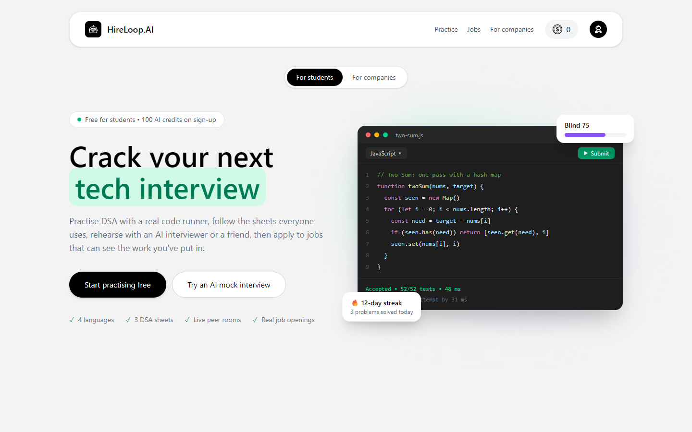
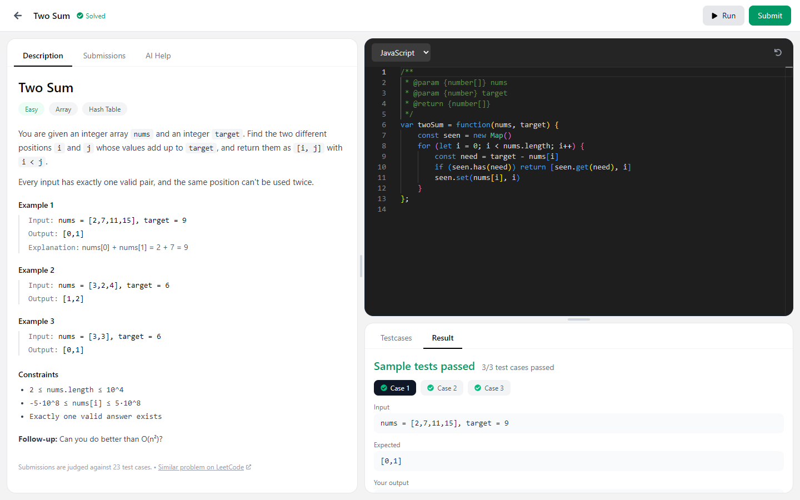
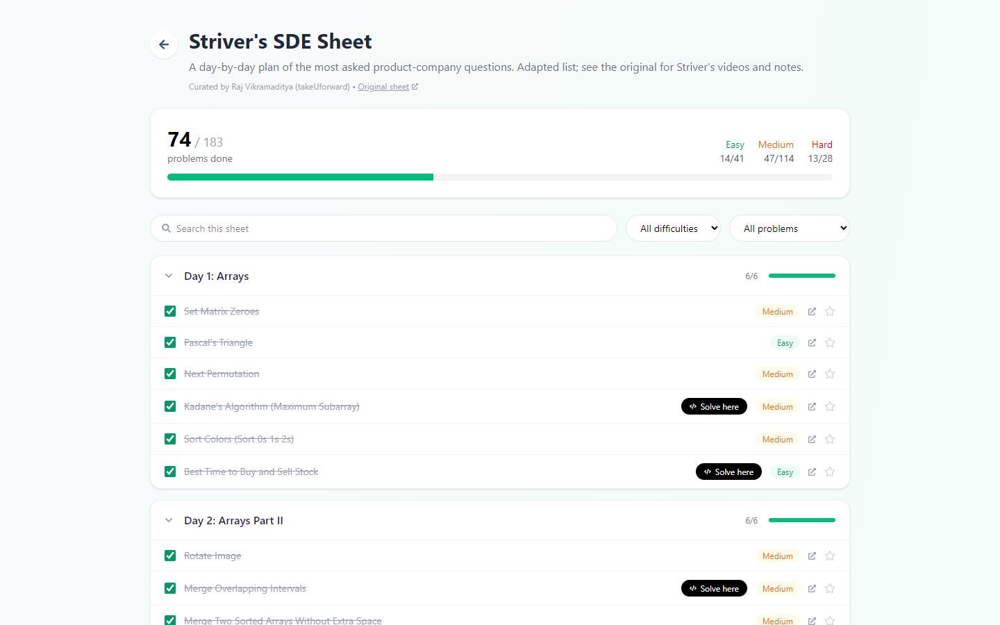
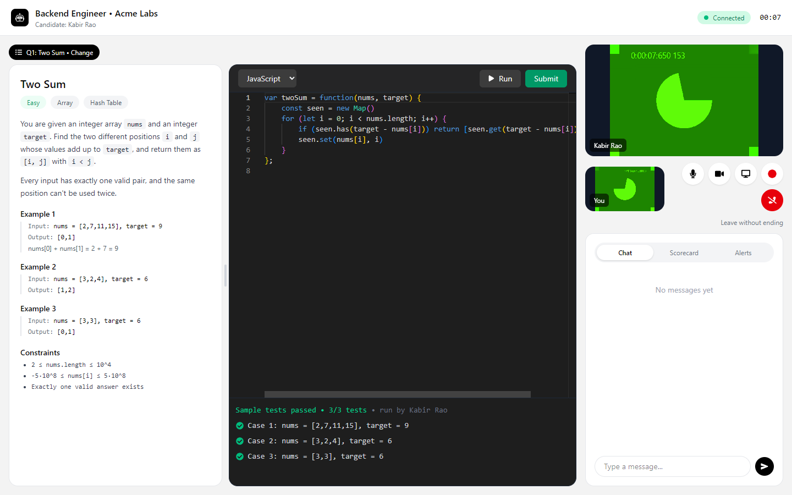
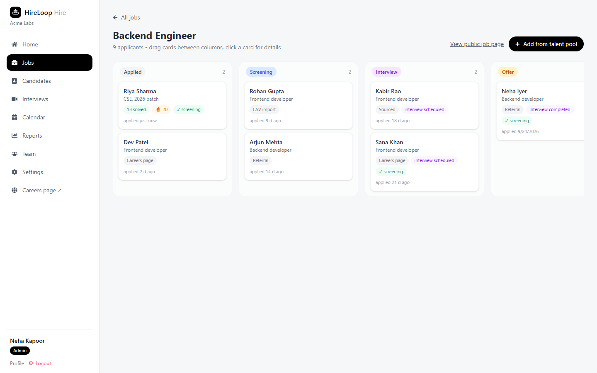
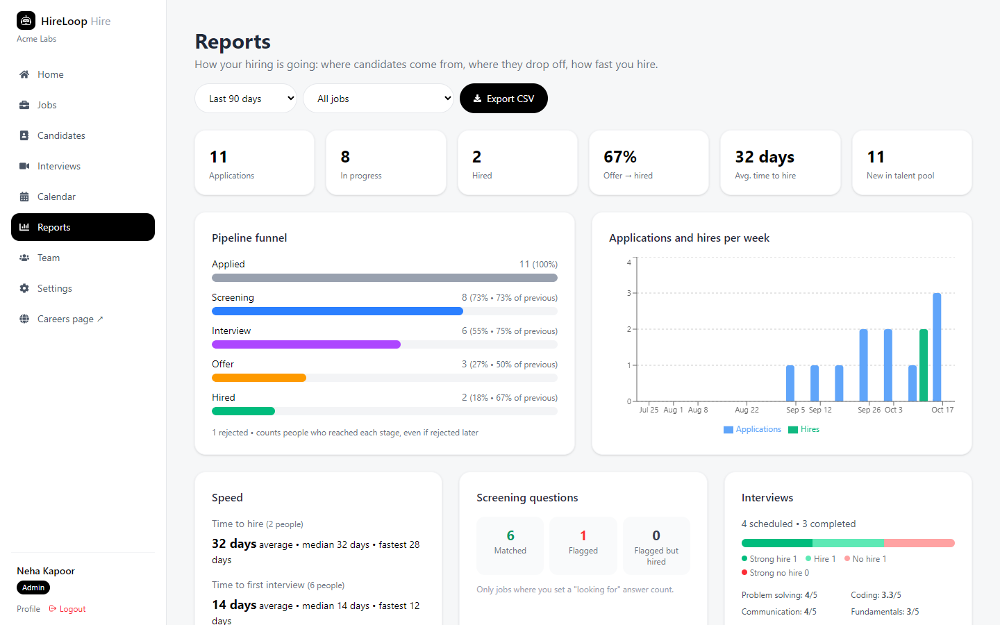
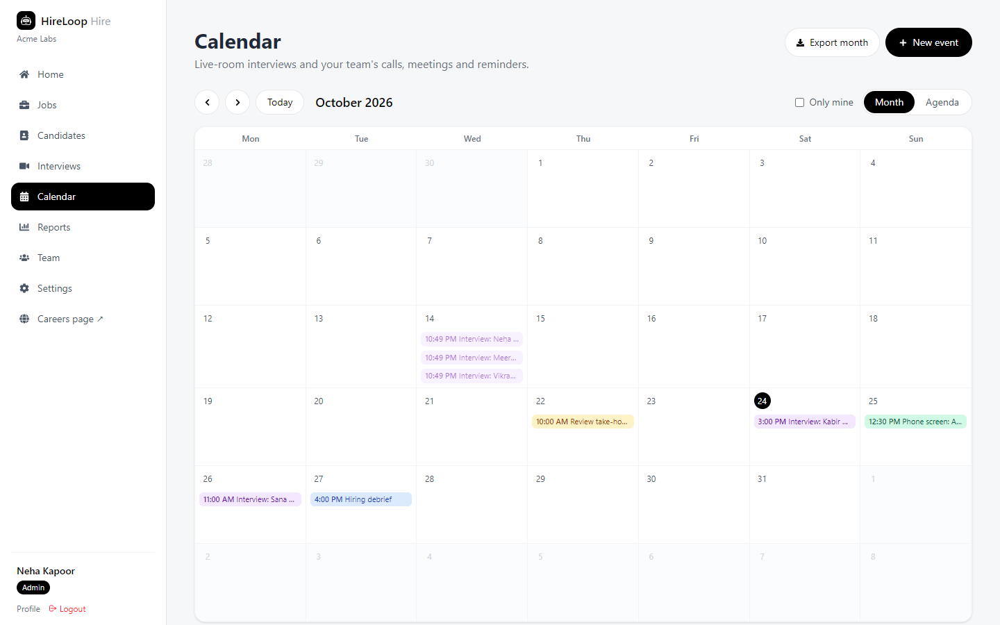
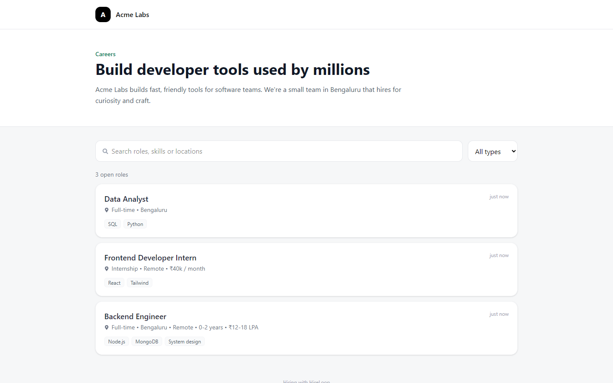
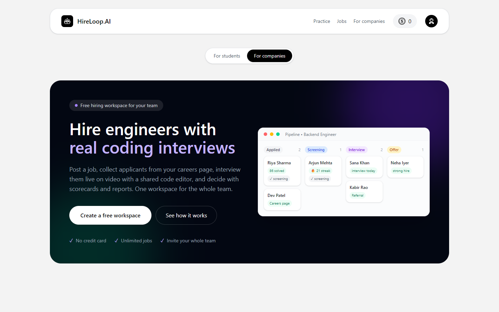

<div align="center">

# HireLoop.AI

**One platform for both sides of the tech interview.**<br>
Students practise and get hired. Companies find, interview and hire them.




</div>

---

## Table of contents

- [What is HireLoop?](#what-is-hireloop)
- [Features](#features)
  - [For students](#for-students)
  - [For companies](#for-companies)
  - [The live interview room](#the-live-interview-room)
- [Screenshots](#screenshots)
- [Tech stack](#tech-stack)
- [Architecture](#architecture)
- [Project structure](#project-structure)
- [Getting started](#getting-started)
- [Environment variables](#environment-variables)
- [How the code runner works](#how-the-code-runner-works)
- [Deployment](#deployment)
- [Security and privacy](#security-and-privacy)
- [API overview](#api-overview)
- [Known limitations](#known-limitations)
- [Acknowledgements](#acknowledgements)

---

## What is HireLoop?

Most students prepare for interviews in one place (LeetCode, YouTube, sheets) and apply for jobs somewhere else, where none of that preparation is visible. Most small companies run hiring across spreadsheets, email and a separate video tool.

HireLoop puts both on one platform:

| | Students | Companies |
|---|---|---|
| **Prepare / Find** | DSA practice with a real code runner, popular DSA sheets, AI and peer mock interviews | A careers page, a jobs board and a talent pool with CSV import |
| **Interview** | Practise in the same live room companies use | Live video interviews with a shared editor, test cases, questions and proctoring |
| **Decide / Apply** | Apply to jobs and *choose* to share their practice record | Pipeline, scorecards, AI summaries, calendar, automatic emails and reports |

Every account picks a side when it signs up: a **student** account sees the practice app, a **company** account gets a separate hiring workspace.

---

## Features

### For students

| Feature | Details |
|---|---|
| **LeetCode-style practice** | 21 original problems with hidden test cases. Write **JavaScript, Python, Java or C++**, then **Run** the examples or **Submit** against every hidden test. Verdicts: Accepted, Wrong Answer, Time Limit Exceeded, Runtime Error, Compilation Error. |
| **DSA sheets** | **Striver's SDE Sheet (183)**, **NeetCode 150** and **Blind 75**, grouped by topic, with progress tracking, a "revisit" star, and "Solve here" for problems that have a built-in version. Solving a problem once ticks it on every sheet. |
| **AI help** | Hints and code analysis on any problem, without giving away the answer. |
| **AI mock interviews** | Choose a role, experience and HR or Technical mode, and optionally upload a resume. The AI asks questions out loud, listens to spoken answers, scores confidence, communication and correctness, and produces a downloadable PDF report. |
| **Peer mock interviews** | Start a live room on any problem and share the link, or join someone's open session: video, screen share, shared editor, chat and recording. |
| **Jobs board** | Browse openings from companies hiring on HireLoop, answer screening questions, and **choose per application** whether to share your practice record (solved count, difficulty mix, streak). Your code is never shared. |
| **Dashboard and history** | Activity heatmap, streak, solved-by-difficulty, recent submissions, past mock reports and the status of every application. |

### For companies

Each company gets a **workspace** shared by the whole hiring team.

| Feature | Details |
|---|---|
| **Team and access levels** | Invite teammates by link or email as **Admin**, **Recruiter** or read-only **Viewer**. |
| **Jobs and pipeline** | Post jobs and move candidates on a drag-and-drop board: Applied → Screening → Interview → Offer → Hired / Rejected. Moving someone *back* asks for confirmation. |
| **Talent pool** | Everyone who applies, plus people you add by hand or **import from CSV** (with a preview before importing). Tags, saved lists, bulk actions, duplicate detection by email, name or phone, and one-click merge. |
| **Activity timeline** | Calls, emails, meetings and notes per candidate, plus automatic entries for applications, stage changes, interviews and emails. |
| **Live interviews** | Schedule from the pipeline. The candidate gets a private link and joins from the browser, with **no account needed**. See [the live interview room](#the-live-interview-room). |
| **Scorecards and AI summary** | Rate problem solving, coding, communication and fundamentals, give a verdict, then generate an AI summary from the ratings, notes, questions asked and the candidate's code. |
| **Calendar** | Interviews, calls, meetings and reminders for the team, with month and agenda views, double-booking warnings, rescheduling, and **Google Calendar / .ics export**. |
| **Careers page** | A public page at `/careers/<your-company>` listing open roles. Anyone can apply without an account. Add **screening questions** (yes/no, multiple choice, short answer) and get mismatches flagged. Spam protection is built in. |
| **Automatic emails** | Application received, moved forward, not moving forward, interview invite and interview moved, each in your own wording, with a live preview, a test send and a log of every email. A candidate is only emailed the first time they reach a stage. |
| **Reports** | Pipeline funnel, applications and hires per week, time to hire, best sources, screening results, interview verdicts, per-job and per-teammate numbers, and a **CSV export** of every application. |

### The live interview room

The same room is used for company interviews and for student practice sessions.

- **Video and audio** peer to peer (WebRTC), with **screen sharing** and **recording** (both people are told when recording starts).
- A **shared Monaco editor** synced live, in JavaScript, Python, Java or C++.
- A **question panel**: the interviewer picks one of the built-in problems (the candidate gets Run and Submit against its tests) or writes their own question, and can switch between questions. Each question's code and best result are saved for the scorecard.
- **Integrity signals** for company interviews: tab switches, leaving full screen and large pastes are shown to the interviewer, and the candidate is told about this before joining.
- **Chat**, a private **scorecard** tab for the interviewer, and a room that is limited to two people.

---

## Screenshots

| | |
|---|---|
| <br>**Practice:** solve a problem and run it against the examples | <br>**DSA sheets:** progress across Striver, NeetCode and Blind 75 |
| <br>**Interview room:** question, shared editor and video | <br>**Pipeline:** practice stats and screening results on each card |
| <br>**Reports:** funnel, speed, sources and interviews | <br>**Calendar:** interviews, calls and reminders |
| <br>**Careers page:** apply without an account | <br>**For companies:** the hiring side of HireLoop |

<sub>Screenshots use a demo workspace with made-up people.</sub>

---

## Tech stack

| Layer | Technology |
|---|---|
| **Frontend** | React 19, Vite 7, React Router 7, Redux Toolkit, Tailwind CSS 4, Monaco Editor, Recharts, Motion, react-resizable-panels |
| **Backend** | Node.js, Express 5, Mongoose 9 |
| **Database** | MongoDB (Atlas) |
| **Real time** | Socket.IO for rooms, chat and editor sync; WebRTC for video, audio and screen share |
| **Auth** | Google sign-in with Firebase, then a JWT in an httpOnly cookie |
| **AI** | OpenRouter (`openai/gpt-4o-mini`) for mock interviews, hints, code analysis and interview summaries |
| **Code execution** | Built-in local runner (Node, Python, Java, C++), with optional Judge0 or Piston |
| **Email** | Nodemailer over SMTP (works free with a Gmail app password) |
| **Payments** | Razorpay (credits for AI mock interviews) |
| **Deployment** | One Docker image (frontend + backend), with a Render blueprint |

---

## Architecture

```mermaid
flowchart LR
    subgraph Browser
        UI[React app<br/>Vite + Tailwind]
        RTC[WebRTC<br/>video / screen]
    end

    subgraph Server["Node.js server (one service)"]
        API[Express REST API]
        WS[Socket.IO<br/>rooms, chat, editor sync]
        RUN[Code runner<br/>JS · Python · Java · C++]
        MAIL[Mail service]
    end

    DB[(MongoDB Atlas)]
    AI[OpenRouter AI]
    SMTP[Gmail SMTP]
    FB[Firebase<br/>Google sign-in]

    UI -- HTTPS + cookie --> API
    UI <-- WebSocket --> WS
    RTC <-. peer to peer, signalled via Socket.IO .-> RTC
    UI --> FB
    API --> DB
    WS --> DB
    API --> RUN
    API --> AI
    API --> MAIL --> SMTP
```

**Key design decisions**

- **One service, one domain.** In production the Express server also serves the built React app, so there are no cross-site cookie or CORS problems, and it deploys as a single Docker container.
- **Video goes browser to browser.** WebRTC sends video directly between the two people, and the server only relays the connection setup through Socket.IO. This keeps the server cheap enough for a free hosting plan. A TURN relay can be added for strict networks.
- **Practice and interviews share one judge.** `server/services/judge.service.js` runs a solution against a problem's tests for both the practice pages and the interview room. Interview attempts never count toward a student's practice record.
- **Workspaces, not single recruiters.** Jobs, candidates, interviews, events and emails belong to an organization. One `requireOrg(minRole)` middleware enforces viewer, recruiter and admin access on every company route.
- **Original problems, linked sheets.** The 21 built-in problems are original, each with a reference solution and seeded test generator. The DSA sheets store only titles and links to the original problems.

---

## Project structure

```
.
├── client/                     # React app (Vite)
│   └── src/
│       ├── pages/              # Student pages, room, landing, careers
│       │   └── company/        # Company workspace pages
│       ├── components/
│       │   ├── room/           # Interview room: editor, chat, scorecard, question picker
│       │   ├── company/        # Calendar, emails, candidate forms, access helpers
│       │   ├── jobs/           # Job utilities, screening questions
│       │   ├── practice/       # Practice UI helpers
│       │   └── landing/        # Landing page sections and mockups
│       ├── hooks/              # useWebRTC, useRecorder
│       └── redux/              # Logged-in user state
├── server/                     # Express API
│   ├── controllers/            # Route handlers
│   ├── models/                 # Mongoose schemas
│   ├── routes/                 # /api/* routers
│   ├── middlewares/            # isAuth, requireRole, requireOrg
│   ├── services/               # Code runner, judge, mail, screening, stats...
│   ├── socket/room.socket.js   # Live room events
│   └── practice/               # Problems, language drivers, DSA sheets
├── docs/screenshots/           # Images used in this README
├── Dockerfile                  # Production image (Node 22 + Python 3 + g++ + JDK 17)
├── render.yaml                 # Render deployment blueprint
└── DEPLOY.md                   # Step-by-step deployment guide
```

---

## Getting started

### Prerequisites

- **Node.js 20+** (the Docker image uses Node 22)
- A **MongoDB** database. A free [MongoDB Atlas](https://www.mongodb.com/atlas) cluster works.
- A **Firebase** project with **Google** sign-in enabled, for login
- Optional, for running code in every language locally: **Python 3**, a **JDK 17+** and **g++**. JavaScript always works because it runs on Node.

### 1. Clone and install

```bash
git clone https://github.com/snsharma0714/hireloop.git
cd hireloop

cd server && npm install
cd ../client && npm install
```

### 2. Configure

Create `server/.env` and `client/.env` (see [Environment variables](#environment-variables)). Minimal `server/.env`:

```env
PORT=8001
MONGODB_URL=mongodb+srv://<user>:<password>@<cluster>/<db>
JWT_SECRET=<any long random string>
CLIENT_URL=http://localhost:5173
```

Minimal `client/.env`:

```env
VITE_FIREBASE_APIKEY=<your Firebase web API key>
```

If you use your own Firebase project, also update `authDomain`, `projectId` and the other values in `client/src/utils/firebase.js`, and add `localhost` to the authorized domains in the Firebase console.

### 3. Run

In two terminals:

```bash
# terminal 1: API on http://localhost:8001
cd server && npm run dev

# terminal 2: app on http://localhost:5173
cd client && npm run dev
```

Open **http://localhost:5173**, sign in with Google, and choose **Student** or **Company**.

---

## Environment variables

### `server/.env`

| Variable | Required | Description |
|---|:---:|---|
| `PORT` | ✅ | Port for the API (use `8001` locally) |
| `MONGODB_URL` | ✅ | MongoDB connection string |
| `JWT_SECRET` | ✅ | Secret used to sign login cookies |
| `CLIENT_URL` | ✅ | Frontend address, for CORS (`http://localhost:5173` locally) |
| `APP_URL` | | Public address used in email links (defaults to `CLIENT_URL`) |
| `OPENROUTER_API_KEY` | | AI mock interviews, hints, code analysis and summaries |
| `RAZORPAY_KEY_ID`, `RAZORPAY_KEY_SECRET` | | Buying credits for AI mock interviews |
| `SMTP_USER`, `SMTP_PASS` | | Turns on automatic emails. With Gmail: your address and an [app password](https://myaccount.google.com/apppasswords) |
| `SMTP_HOST`, `SMTP_PORT`, `MAIL_FROM` | | Other email providers (defaults: Gmail, port 465, `SMTP_USER`) |
| `JUDGE0_URL`, `JUDGE0_API_KEY` | | Use a Judge0 server instead of the built-in runner |
| `PISTON_URL` | | Use a Piston server instead of the built-in runner |
| `RUNNER_EXTRA_PATH` | | Extra folders to search for compilers, e.g. a JDK `bin` folder on Windows |
| `PYTHON_CMD` | | Python command (default `python` on Windows, `python3` elsewhere) |
| `RUNNER_UID`, `RUNNER_GID` | | Linux only: run submitted code as this unprivileged user (set in the Docker image) |

### `client/.env`

| Variable | Required | Description |
|---|:---:|---|
| `VITE_FIREBASE_APIKEY` | ✅ | Firebase web API key for Google sign-in |
| `VITE_RAZORPAY_KEY_ID` | | Razorpay public key for checkout |
| `VITE_SERVER_URL` | | API address. Defaults to `http://localhost:8001` in development and the same domain in production |
| `VITE_TURN_URL`, `VITE_TURN_USERNAME`, `VITE_TURN_CREDENTIAL` | | Optional TURN server for video calls on strict networks |

> `.env` files are listed in `.gitignore` and are never committed.

---

## How the code runner works

1. The editor sends the user's function, for example `twoSum(nums, target)`.
2. `server/practice/drivers.js` wraps it in a full program for the chosen language that reads the test inputs, calls the function and prints each result with a marker.
3. `server/services/codeRunner.service.js` compiles and runs it with time and memory limits.
4. `server/services/judge.service.js` compares each output with the expected answer and returns the verdict, the number of tests passed and the first failing case.

| Backend | When it's used |
|---|---|
| **Built-in runner** (default) | Free, with no external service. Runs Node, Python, Java and C++ installed on the machine. On Linux (Docker), code runs as an unprivileged user with `prlimit` limits, and secrets are removed from its environment. |
| **Judge0** | Set `JUDGE0_URL` (and `JUDGE0_API_KEY` for RapidAPI) |
| **Piston** | Set `PISTON_URL` |

---

## Deployment

The app ships as **one Docker image** that builds the React app and runs the Express server with Python 3, g++ and JDK 17 installed for the code runner.

**Render (free plan):** create a new **Blueprint** from this repository. Render reads [`render.yaml`](render.yaml) and asks for the secret values once. The full walkthrough, including MongoDB Atlas network access, Google sign-in domains and email, is in **[DEPLOY.md](DEPLOY.md)**.

```bash
# or run the production image yourself
docker build -t hireloop .
docker run -p 8001:8001 --env-file server/.env -e RUNNER_EXTRA_PATH= hireloop
```

---

## Security and privacy

- **Authentication:** Google sign-in through Firebase, then a JWT stored in an **httpOnly**, `SameSite=Strict` cookie (`secure` in production).
- **Authorization:** every company route checks the workspace and role (viewer, recruiter or admin). Students and companies can't use each other's APIs, and one workspace can never read another's data.
- **Interview links:** each room has a random secret token. Rooms hold two people at most, viewers can't join, and the room's Run/Submit stops working once the interview ends.
- **Consent first:** a student's practice record is shared with a company only when they tick the box on that application, and their code is never shared. Candidates are told about integrity alerts and recording.
- **Screening questions:** the answer a company is looking for is never sent to applicants.
- **Public forms:** the careers page has a hidden spam-trap field and a rate limit of 5 applications per network every 10 minutes.
- **Code execution:** time and memory limits, process-group kill on timeout, an unprivileged user on Linux, and environment variables (secrets) removed before user code runs.
- **CSV export:** cells that start with `=`, `+`, `-` or `@` are escaped so spreadsheets can't run them as formulas.

---

## API overview

All endpoints are under `/api`.

| Route | Purpose |
|---|---|
| `/auth` | Google sign-in, logout |
| `/user` | Current user, choose student/company, profile |
| `/practice` | Problems, run, submit, submissions, hints, code analysis, stats |
| `/sheets` | DSA sheets and progress |
| `/code` | Run code with custom input |
| `/interview` | AI mock interviews (resume analysis, questions, answers, reports) |
| `/schedule` | Interview rooms, peer sessions, room tests, scorecards, AI summaries |
| `/jobs` | Jobs board, applying, company jobs, pipeline, scheduling |
| `/candidates` | Talent pool, activity, CSV import, lists, merge, emails |
| `/org` | Workspace settings, team, invites, overview, email settings |
| `/calendar` | Calendar entries and events |
| `/careers` | Public careers pages and applications |
| `/reports` | Hiring reports and CSV export |
| `/payment` | Razorpay orders and verification |
| `/health` | Health check |

Live room events (Socket.IO): `join-room`, `signal`, `code-change`, `run-output`, `judge-result`, `chat`, `media-state`, `proctor`, `recording`, `set-question`, `get-questions`, `end-interview`.

---

## Known limitations

- **Free hosting sleeps.** On Render's free plan the app pauses after about 15 minutes without visitors and takes 30–60 seconds to wake up.
- **Video on strict networks.** Calls connect browser to browser. Some campus or office networks block this unless a TURN server is configured (`VITE_TURN_*`).
- **Languages depend on the machine.** Locally, Python, Java and C++ need their compilers installed. The Docker image includes all of them.
- **Resumes are links, not uploads,** because free hosting has no permanent disk.
- **Tests.** The features were tested end to end with automated browser scripts during development. Those scripts aren't part of this repository yet.

---

## Acknowledgements

- DSA sheets curated by **Raj Vikramaditya (takeUforward)** for Striver's SDE Sheet, **NeetCode** for NeetCode 150, and **Yangshun Tay** for Blind 75. HireLoop links to the original problems and tracks your progress. It doesn't copy their content.
- The built-in practice problems, tests and reference solutions are original. Problems link to similar problems on LeetCode for further practice.
- [Monaco Editor](https://microsoft.github.io/monaco-editor/), [Socket.IO](https://socket.io/), [OpenRouter](https://openrouter.ai/), [Recharts](https://recharts.org/) and the other open-source libraries listed in each `package.json`.

---

<div align="center">

Built by **[snsharma0714](https://github.com/snsharma0714)**

</div>
